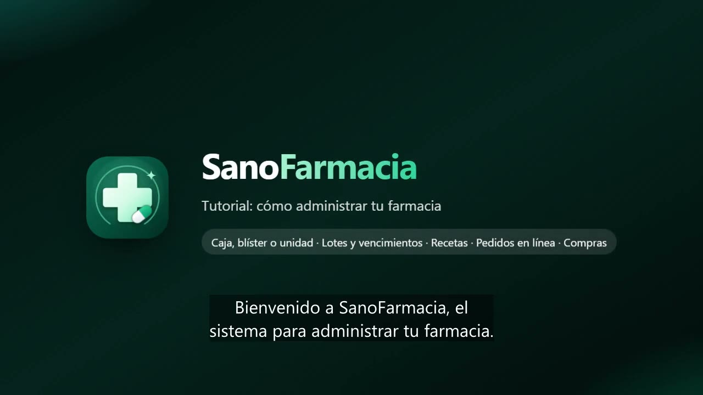

# SanoLicores 🍾

Software de gestión para licorerías de la línea **Sano** (SanoGym, SanoDental, SanoDoctor, SanoTecnico, SanoGestion, SanoCortes, SanoFarmacia).
PWA instalable (PC, tablet, Android, iPhone) y mundial: el país se elige la primera vez y define moneda,
formas de pago y código de WhatsApp. Opcionalmente trabaja con una segunda moneda (dólares y bolívares con la tasa BCV del día).

**Producción:** https://sano-licores.web.app · **Credenciales:** `CREDENCIALES_SANO_LICORES.txt` (no se sube a git)



## Qué hace

| Módulo | Detalle |
|---|---|
| Vender | Lector de código de barras o búsqueda por nombre, tipo o marca. Venta por **unidad, six-pack o caja**, **fría o al tiempo** (recargo por frío por unidad), al **detal o al mayor** (precio al mayor automático al elegir un cliente mayorista). Pestañas de más vendidos, frías, combos y categorías. Sugiere otra marca del mismo tipo y tamaño si algo se agota. |
| Combos | Arma combos (ron + refrescos + hielo, cerveza + hielo…) con su precio; al venderlo descuenta cada producto y calcula cuántos se pueden armar con lo que hay. |
| Envases retornables | Botellas 1/3, 1 L, gaveras o los que quieras. Al vender cerveza o refresco retornable pregunta cuántos vacíos trae: los que faltan se **cobran como depósito** o se **prestan** al cliente (queda debiendo). Depósito de vacíos, entrega a la distribuidora, conteo físico con PIN e historial. |
| Clientes | Ficha con cédula, tipo (detal / al mayor), negocio, límite de fiado, bebida favorita, compras y envases que debe. Importar/exportar CSV. |
| Fidelidad y fiados | Clientes que dejaron de venir (con oferta para que vuelvan por WhatsApp), quién debe fiado, clientes al mayor, cumpleaños y puntos. **Fiado con límite** por cliente. Tarjeta digital `/tarjeta/CÓDIGO` con QR, puntos, fiado y envases pendientes. |
| Pedidos en línea | Catálogo público `/pedido/NOMBRE`: el cliente pide por unidad o por caja, marca si las quiere **bien frías** y elige delivery o retirar, sin crear cuenta (con pedido mínimo opcional). La licorería lo acepta, lo prepara, avisa por WhatsApp y lo cobra en un toque. |
| Inventario | Stock en unidades con lotes y vencimientos (sale primero lo que vence antes), **roturas**, cortesías, mermas, devoluciones y conteo físico con PIN. |
| Compras | Sugerido de compra según mínimos, órdenes por WhatsApp a las distribuidoras, recepción con lote, vencimiento y costo promedio ponderado, y **cuentas por pagar** con vencimiento. |
| Caja y facturas | Apertura, gastos/ingresos y cierre con diferencia; facturas con presentación, frío, envases y fiado; anulación con PIN que devuelve producto y envases. |
| Reportes | Ventas y ganancia por día, top por ventas y rentabilidad, por presentación, **vendido frío**, ventas al mayor, depósitos de envases, envases recibidos/prestados, pérdidas por rotura y vencimiento, formas de pago, horas pico y vendedores. |
| Licencia | Guarda el número y vencimiento de la licencia de expendio y avisa en el inicio 30 días antes. |
| Consulta de precios | Pantalla tipo kiosco: el cliente escanea y ve el precio por unidad, fría y por caja. Salir pide PIN. |
| Demo | 30 minutos sin registro con una licorería completa de ejemplo (PIN 1234) y recorrido guiado; todo se borra al terminar. |

## Estructura

- `public/` — la app (JavaScript sin compilación + Firebase 10.14.1). `js/views/` una pantalla por archivo; `js/ops.js` reglas de negocio (ventas, lotes, envases, combos, compras, pedidos); `js/licor.js` presentaciones, precios (frío, al mayor), combos y envases.
- `firestore.rules` — cada licorería solo ve lo suyo (`tenants/{uid}`); `cards/{código}` y `shops/{nombre}` se leen solo por clave exacta; `orders` valida cada pedido en línea.
- `scripts/` — aprovisionamiento, pruebas y video tutorial.

## Comandos (desde `scripts/`)

```sh
# Emuladores (en la carpeta del proyecto)
firebase emulators:start --only auth,firestore,hosting --project sano-licores   # app en http://127.0.0.1:5161/?emu=1

sh test-emu.sh                 # crea 3 cuentas en el emulador y corre la prueba E2E (52 verificaciones)
node mobile-check.mjs          # sin scroll lateral de 320 px a 1366 px
node prod-smoke.mjs            # prueba rápida en producción (la demo se limpia sola)
node pwa-check.mjs             # instalable en PC y Android

node provision.mjs 20          # crea/actualiza las cuentas en producción
node icons.mjs                 # regenera íconos y logos desde public/assets/logo.svg
node tutorial/make-video.mjs   # graba el video tutorial narrado (voz es-VE)
firebase deploy --only firestore,hosting --project sano-licores
```
